# Picard

Picard er et program som standardiserere navn og tags for musikkfilene dine.

- Installer: [ https://picard.musicbrainz.org/downloads/ ](https://picard.musicbrainz.org/downloads/)
- Wiki: [https://picard-docs.musicbrainz.org/en/latest/about_picard/introduction.html](https://picard-docs.musicbrainz.org/en/latest/about_picard/introduction.html)

## Wizzard (Oppstartshjelper)

Første gang du starter picard får du opp en wizzard som hjelper deg å sette opp programmet. Her kommer en beskrivelse av hva du bør endre.

**Tips:** Hvis du lukker vinduet med et uhell, kan du åpne det igjen ved å trykke: **Help** --> **Show setup wizzard...**

### Organisering av filer

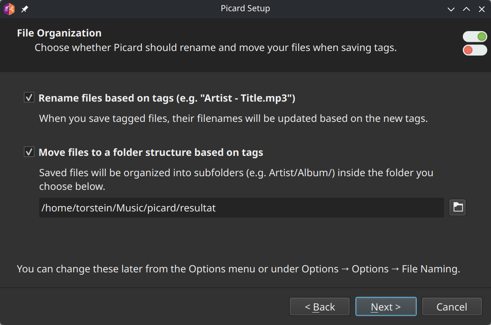

1. Huk av på _«Rename files based on tags (e.g. "Artists -Title.mp3")»_

2. Huk av på _«Move files to a folder structure based on tags»_

3. Velg hvilken mappe som du vil at picard skal lagre resultatet i.
    - Anbefaler at mappen slutter med `picard/resultat`

### Albumbilder

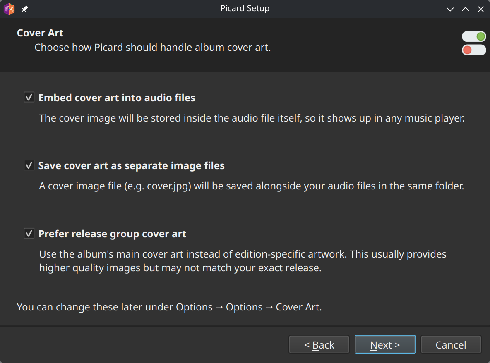

1. Huk av på _«Save cover art as separate image files»_

### Ekstra metadata

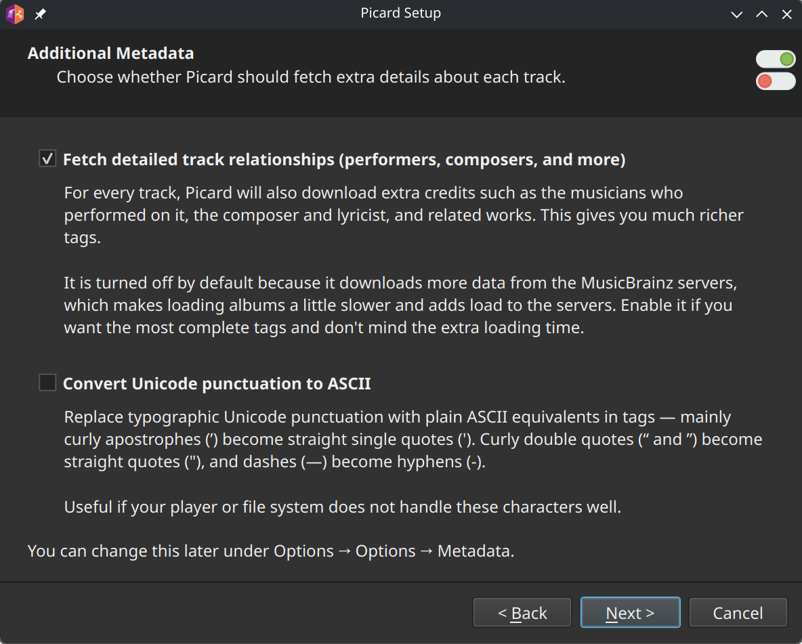

1. Huk av på _«Fetch detailed track relationships (performers, composers, and more)»_

### Oppdateringer

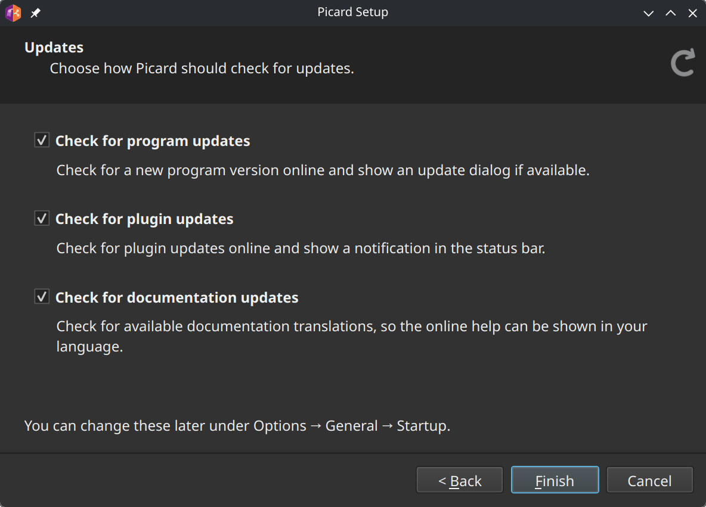

1. **Windows** og **Mac**: Huk av på _«Check for prgoram updates»_
2. **Alle**: Huk av på _«Check for plugin updates»_
3. **Alle**: Huk av på _«Check for documentation updates»_

## Videre konfigurering

Åpne instillinger:

### Metadata

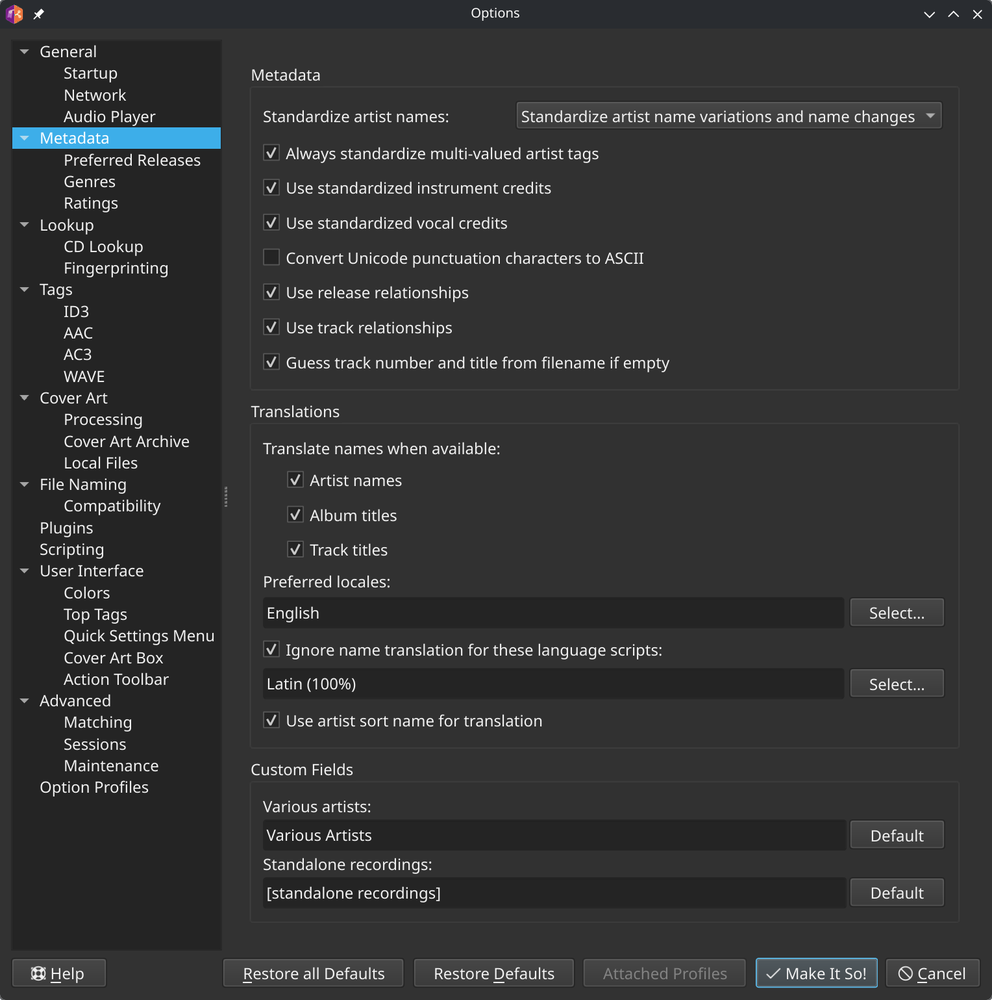

1. Velg _«Standardize artist name variations and name changes»_
2. Huk av på _«Always standardize multi-valued artist tags»_

Følgende innstillinger gjør at andre alfabeter oversettes til engelsk.  
Eksempel: Den kjente komponisten 植松 伸夫 vil bli oversatt til Nobuo Uematsu.

Under _«Translations»_:

1. Huk av på _«Artist names»_
2. Huk av på _«Album titles»_
3. Huk av på _«Track titles»_
4. Sett **English** på _«Preferred locales»_
5. Huk av på _«Ignore name translation for these language script»_
    - Sett feltet til **Latin (100%)**
6. Huk av på _«Use artist sort name for translation»_

### Genres

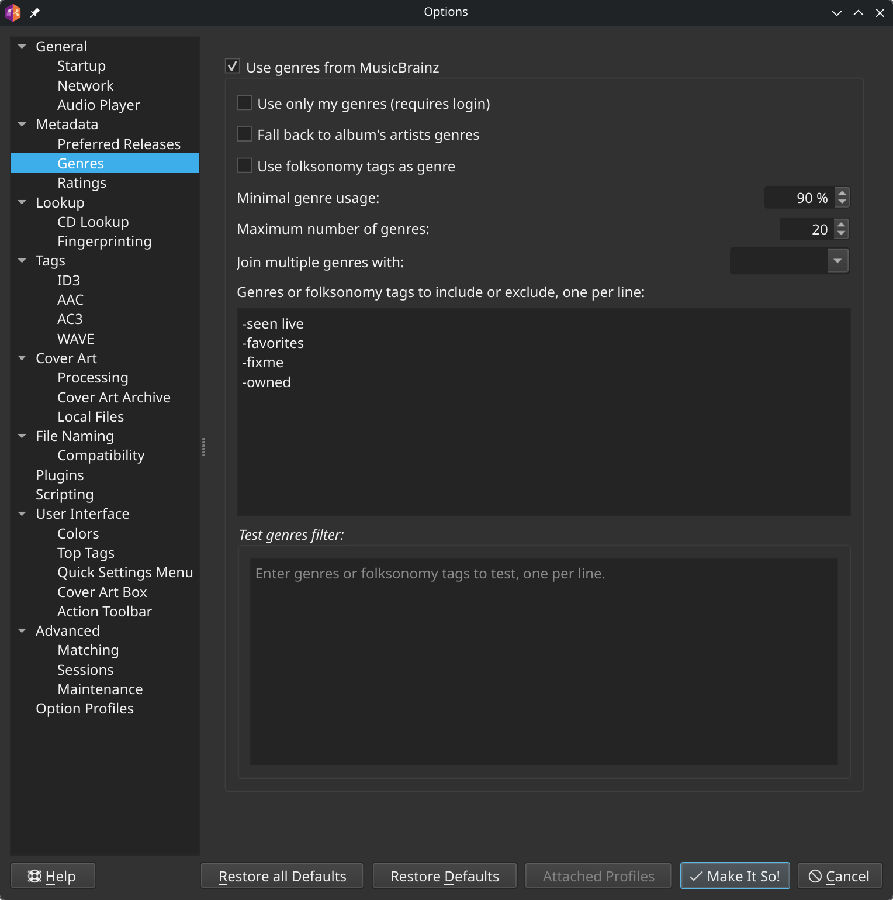

1. Huk av på _«Use genres from MusicBrainz»_
2. Sett _«Maximum number of genres»_ til 20

### Tags


1. Huk av på _«Fix missing seekpoints for FLAC files»_

### Cover Art

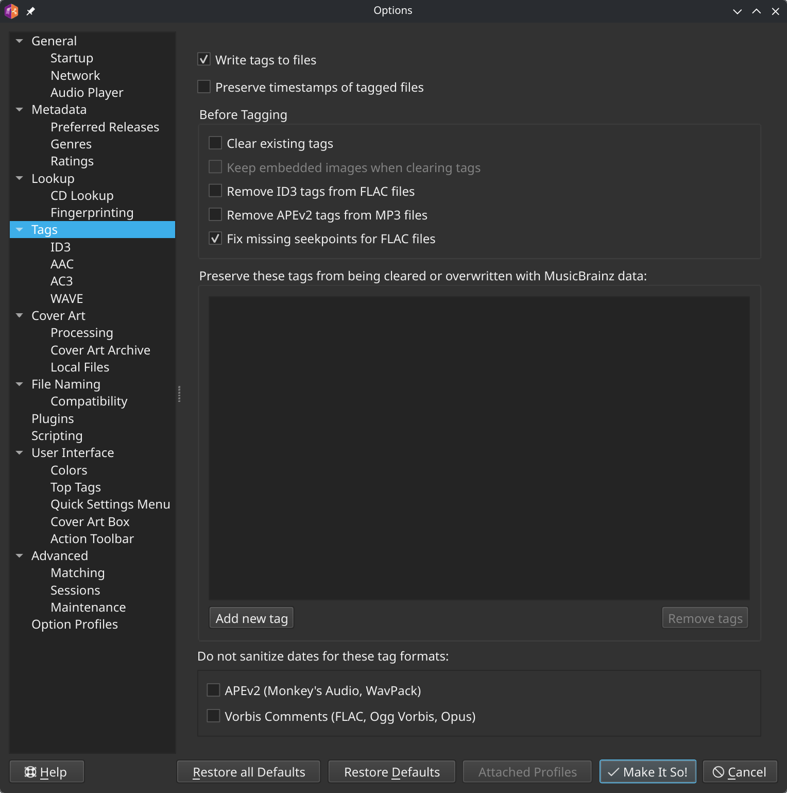

1. Huk av på _«Overwrite the file if it already exists»_

### Processing

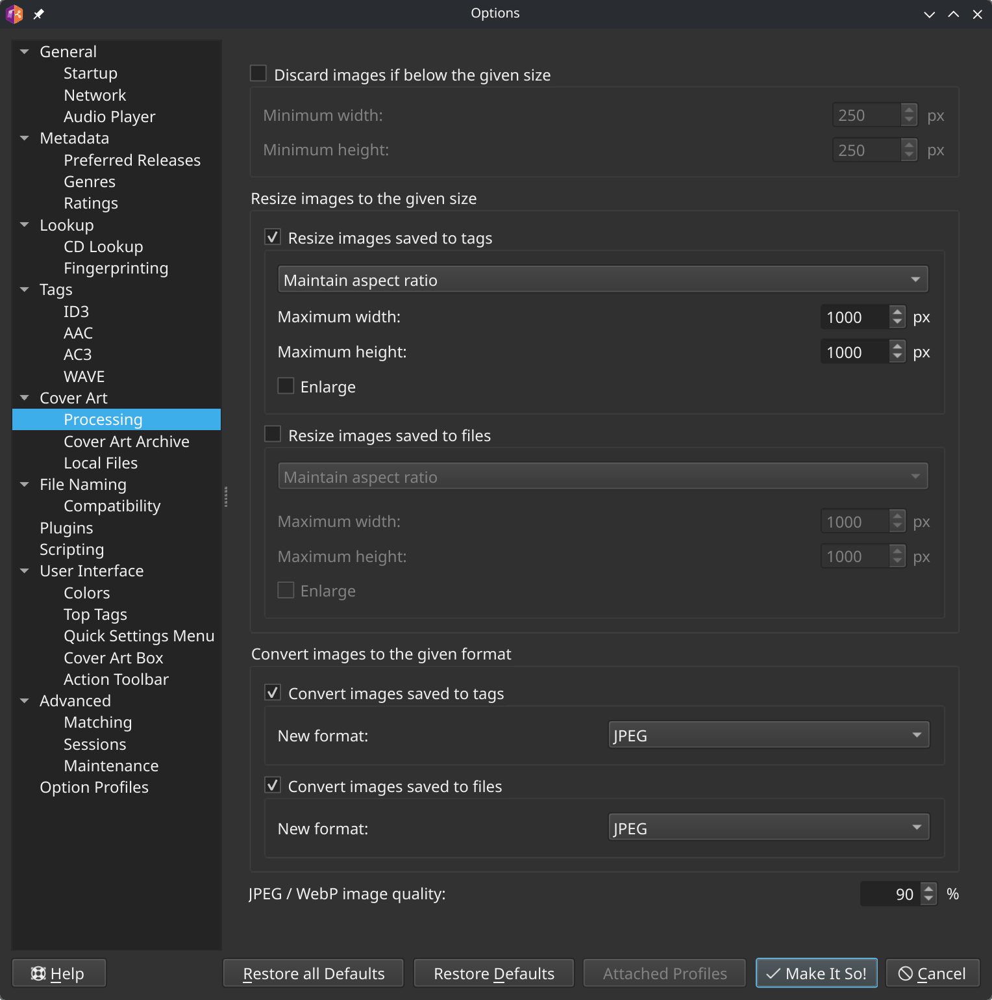

1. Huk av på _«Resize images saved to tags»_
    - Sett _«Maximum width»_: 1000
    - Sett _«Maximum height»_: 1000
2. Huk av på _«Convert images saved to tags»_
3. Huk av på _«Convert images saved to files»_

### Cover Art Archive

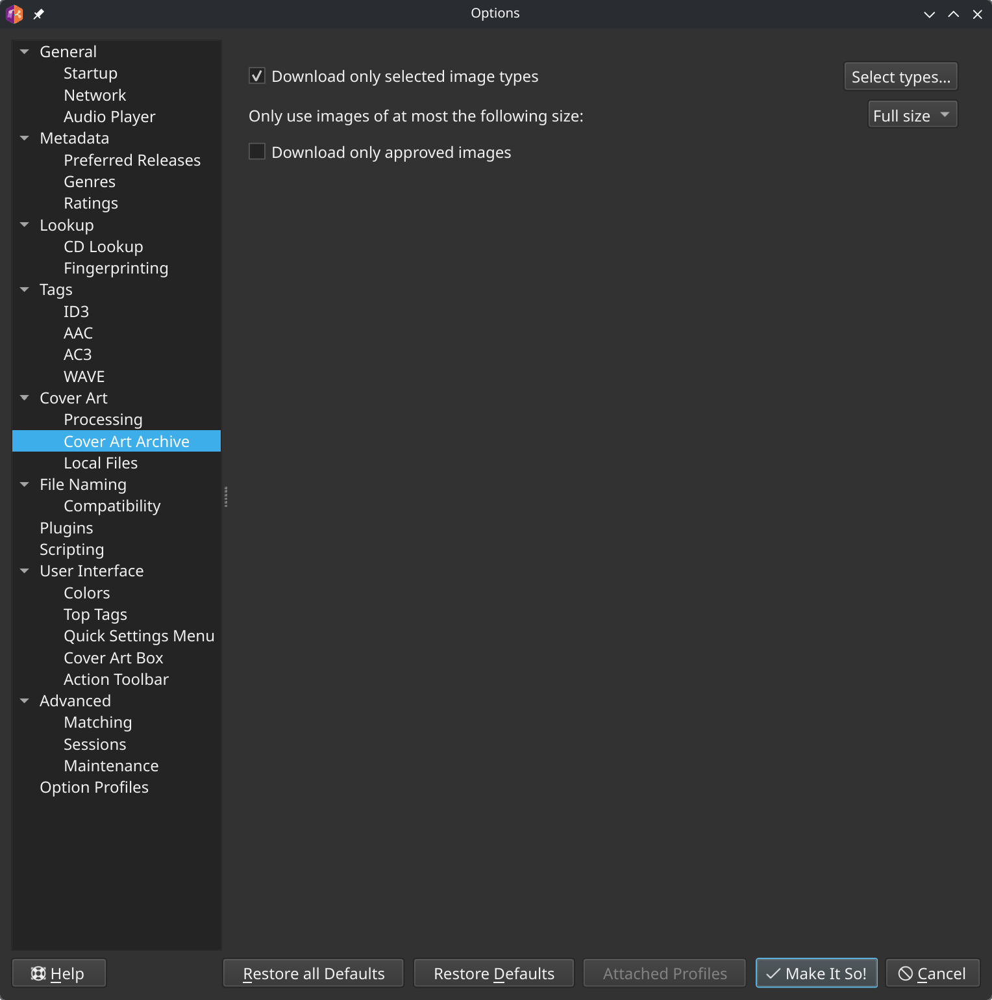

1. Velg _«Full size»_ på _«Only use images of at most the following size»_

### Scripting

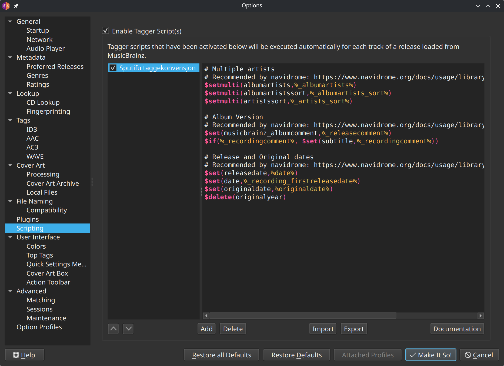

1. Huk av på _«Enable Tagger Script(s)»_

2. Lim inn:

```taggerscript
# Multiple artists
# Recommended by navidrome: https://www.navidrome.org/docs/usage/library/tagging/#picard-specific-tips
$setmulti(albumartists,%_albumartists%)
$setmulti(albumartistssort,%_albumartists_sort%)
$setmulti(artistssort,%_artists_sort%)

# Album Version
# Recommended by navidrome: https://www.navidrome.org/docs/usage/library/tagging/#picard-specific-tips
$set(musicbrainz_albumcomment,%_releasecomment%)
$if(%_recordingcomment%, $set(subtitle,%_recordingcomment%))

# Release and Original dates
# Recommended by navidrome: https://www.navidrome.org/docs/usage/library/tagging/#picard-specific-tips
$set(releasedate,%date%)
$set(date,%_recording_firstreleasedate%)
$set(originaldate,%originaldate%)
$delete(originalyear)
```

### Lagre

Lagre endringene du har gjort så langt ved å trykke på _«Make It So!»_

### Standardisering av filnavn

1. Gå til **Options** --> **File naming scripts** --> **Edit scripts...**

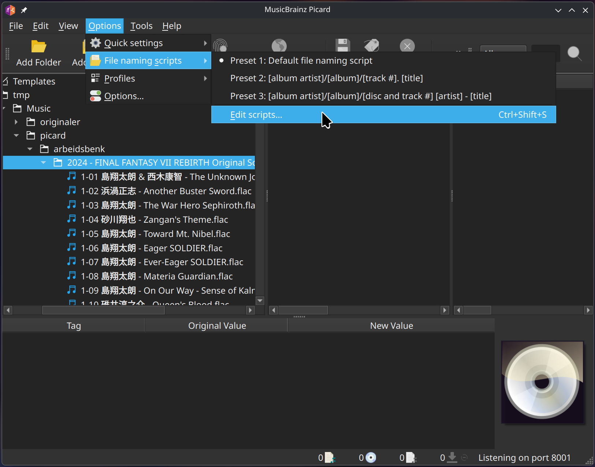

2. Gå til **Script** --> **Add a new script** --> **Empty / blank script**

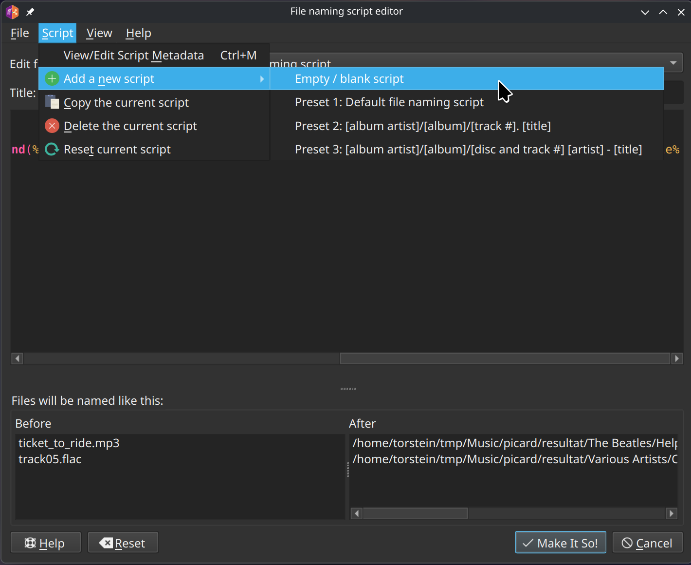

3. Lim inn følgende:

```taggerscript
$noop(--- Artist folder ---)
$set(_artist_folder,$if2(%albumartist%,%artist%))

$noop(--- Album folder ---)
$noop( Prefix year in front of album )
$noop( Use original release year if known, otherwise release year )
$set(_year,$if2($left(%originaldate%,4),$left(%date%,4)))
$set(_year_prefix,$if(%_year%,%_year% - ,))
$set(_album_folder,%_year_prefix%%album%)

$noop(--- File name ---)
$noop( 1. Make all disk numbers have the same amount of digits)
$set(_disc_number, $num(%discnumber%, 1))
$if($gt(%totaldiscs%,9),$set(_disk_number,$num(%discnumber%,2)))

$noop( 2. Make all track numbers have the same amount of digits)
$set(_track_number,$num(%tracknumber%,1))
$if($gt(%totaltracks%,9),$set(_track_number,$num(%tracknumber%,2)))
$if($gt(%totaltracks%,99),$set(_track_number,$num(%tracknumber%,3)))

$noop( 3. Build track file name)
$set(_disc_prefix,$if($gt(%totaldiscs%,1),%_disc_number%-,))
$set(_track_prefix,$if(%_album_folder%,%_track_number% ))
$set(_track_filename,%_disc_prefix%%_track_prefix%%title%)

$noop(--- Final path ---)
$if(_artist_folder,%_artist_folder%/)
$if(_album_folder,%_album_folder%/,)
%_track_filename%
```

4. Lagre scriptet som _«Sputifu navnekonvensjon»_

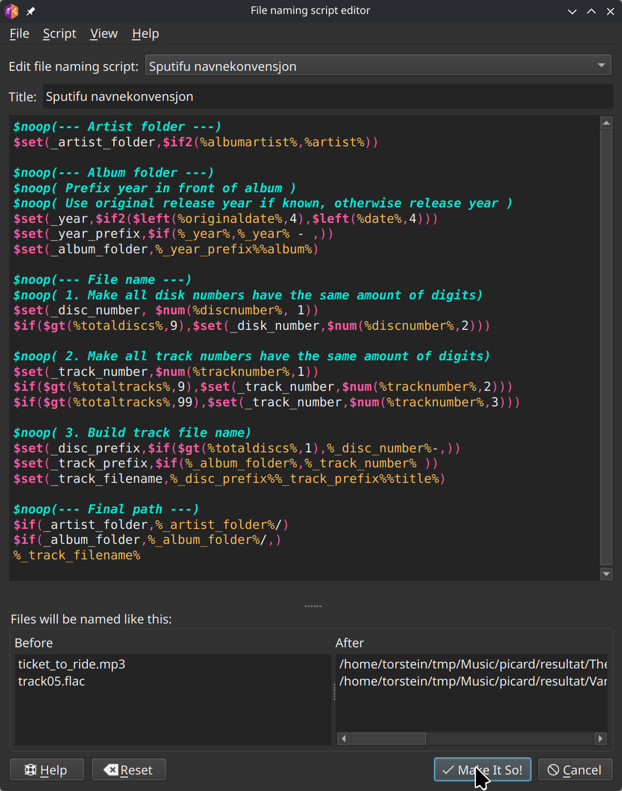

5. Trykk på _«Ja»_ til å aktivere scriptet nå.

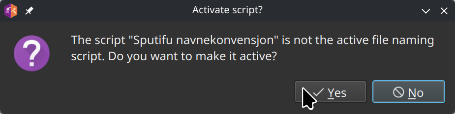
