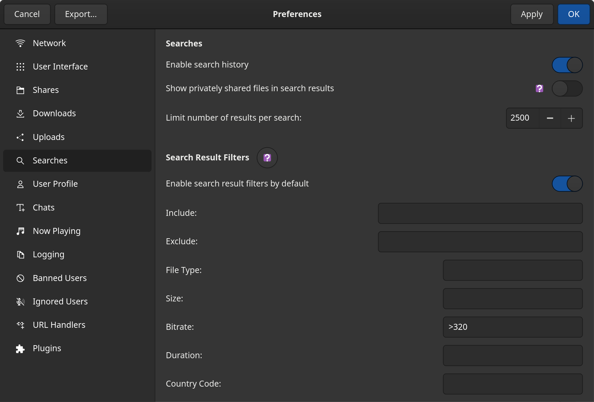
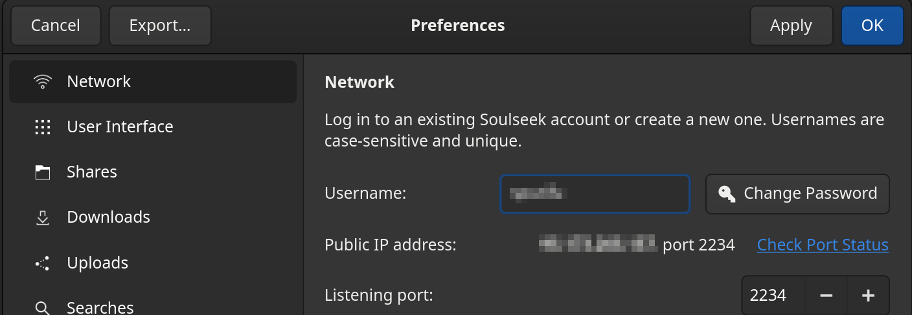
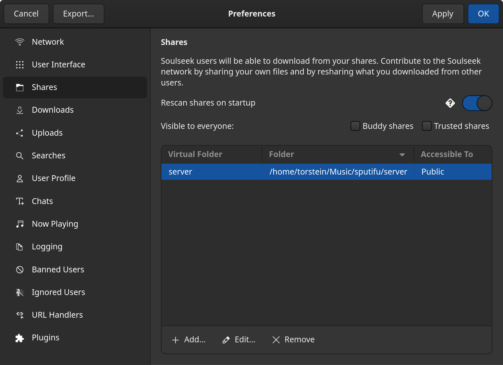

# Soulseek

Soulseek er et nettverk for folk som deler musikk.

For å ikke bli bannet på Soulseek må du dele musikk tilbake.
For å dele filer må du åpne en port på nettverket ditt.
Det enkleste og beste er å åpne en port via VPN. Hvis du er cowboy, kan du åpne porten på ruteren.

**Anbefaling: Bruk beskyttelse – bruk VPN.**

Se [VPN-guiden](./vpn.md) for å se hvordan sette opp VPN for Soulseek.

# Nicotine+

Nicotine+ er et program som kan koble deg på Soulseek nettverket.

- Forskjellen mellom Soulseek og Nicotine+ er den samme som Forskjellen mellom internett og Firefox.

## Oppsett

### Opprett bruker

- Start opp Nicotine, og legg inn brukernavn og passord. Brukeren opprettes automatisk.

### Finn filer av høy kvalitet

- **Settings** --> **Searches** --> **Bitrate** --> Skriv inn: >320
    - Dette gjør at du stort sett bare ser høykvalitets .flac filer når du søker opp musikk.

### Velg port

- **Settings** --> **Network** --> **Listening Port** --> Skriv inn porten som er åpen.
- Klikk på **«Check Port Status»** for å bekrefte at alt funker.

### Del musikk med andre

- **Settings** --> **Shares** --> **Add...** --> Velg hvilken mappe du vil dele med andre på soulseek.
    - Hvis du følger [anbefalt mappestruktur](./opplaste-album.md#mappestruktur), så bør du dele mappen `sputifu/server`

## Tips & Triks

### Filtyper

Se hvilke [filer vi foretrekker](../regler.md#foretrukne-filer)

### Ingen søkeresultater dukker opp?

Pga advokater er noen søkeord svartelistet. Dette gjelder f.eks. _Linkin Park_.

Måten man kommer seg rundt dette på er å søke opp albumtittel eller sangnavn. F.eks. _«Hybrid Theory»_ eller _«One Step Closer»_.

Når du finner en match kan du høyreklikke og velge **«Browse Folder»**. Det er høy sannsynlighet for at denne brukeren har flere skatter å dele ut.

### Oppdag musikk

- Bruk **«Browse Folder»** ofte! Det er en veldig fin måte å snuble over musikk på.

- Hvis du finner en bruker som har lik musikksmak som deg, legg vedkommende til i vennelisten din slik at du kan finne hen senere.
